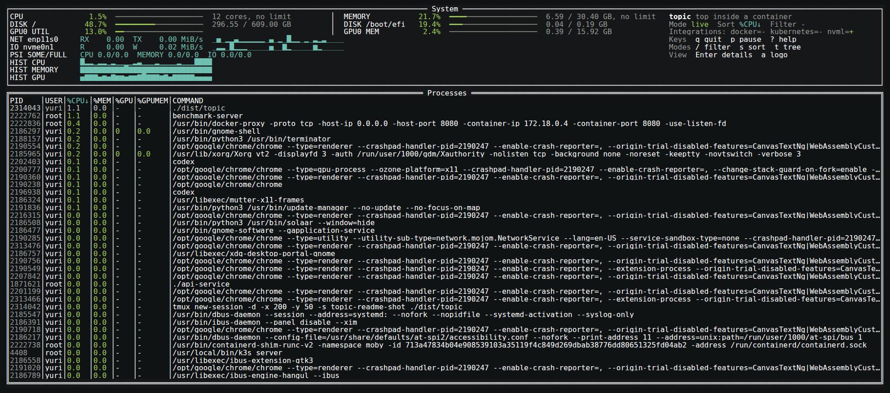

<div align="center">


### topic: top inside a container

**A `top`-like tool for containers that displays resource usage based on cgroup limits, not the host's resources.**

[](https://github.com/yurirocha15/topic/actions/workflows/ci.yml)
[](https://github.com/yurirocha15/topic/releases/latest)

</div>

---

### The Problem

Traditional monitoring tools like `top` or `htop`, when run inside a container, report resource usage as a percentage of the **host machine's total resources**. When working in containerized environments like Kubernetes Pods, it is hard to monitor the resource usage from inside the container.

For example, a container with a **2GB memory limit** on a 128GB host may be using 1.8GB of RAM. While `htop` would show a negligible system-wide usage, the container is actually at 90% of its capacity and is dangerously close to being OOMKilled with no warning.

### The Solution

**topic** (top inside a container) is a simple terminal-based monitoring tool that solves this problem. It reads the container's resource limits directly from the cgroup filesystem and calculates all usage percentages based on those limits.

This provides an accurate view of how close a container is to its resource boundaries, without the need to access the host or external monitoring tools.



The screenshot is captured inside a demo container limited to 2 CPUs, 2 GiB of memory, and 256 PIDs, with a synthetic CUDA workload using an attached GPU.

### Dashboard

The system panel adapts to the terminal width. Wide terminals use two aligned resource columns; narrower terminals switch to one column and truncate secondary details before hiding primary measurements.

- CPU, memory, storage, and GPU rows share the same label, percentage, bar, and detail alignment.
- Network and disk throughput, PID usage, cgroup pressure, and metric history use a shared label gutter for quick scanning.
- Utilization is green below 70%, gold from 70% to 89.9%, and red at 90% or above.
- Docker, Kubernetes, and NVIDIA/NVML availability is shown in the compact status panel. Missing integrations remain non-fatal.

### How Metrics Are Measured

- **CPU:** when the cgroup sets a CPU limit that differs from the host core count, usage is a percentage of that limit. Otherwise `topic` shows host CPU usage. Container CPU is calculated from the change between two readings, so the first refresh shows 0%.
- **Memory:** usage is the working set, which is memory in use minus the inactive file cache the kernel can reclaim, the same measure `kubectl top` reports. It is shown as a percentage of the cgroup memory limit. With no limit (`max` on cgroup v2, or the near-maximum value cgroup v1 uses for "unlimited"), `topic` shows host memory instead.
- **Processes:** `%CPU` is usage since the previous refresh as a percentage of the CPU limit, so a process shows 0 on its first refresh. `%MEM` is resident memory as a percentage of the memory limit, or of host memory when there is no limit.
- **Storage:** virtual filesystems, system mounts such as `/dev`, `/proc`, `/run`, and `/tmp`, and single files bind-mounted into the container, such as `/etc/hosts`, are hidden. Mount paths are compared by whole path segment, so a disk mounted at `/developer` stays visible.
- **GPU:** GPUs are labelled by their `nvidia-smi` index. If a GPU does not report its total memory, its memory row shows the amount used at 0%.
- **Docker and Kubernetes:** container IDs are read from the cgroup paths used by cgroupfs and systemd drivers, including `docker-<id>.scope`, `cri-containerd-<id>.scope`, `crio-<id>.scope`, and `libpod-<id>.scope`.

---

### Installation

You can install the latest version of `topic` with a single command. The script will automatically detect your system's architecture (amd64/arm64) and install the binary to a directory in your `PATH`.

```bash
curl -s https://raw.githubusercontent.com/yurirocha15/topic/main/install.sh | bash
```

or for containers based on `alpine`:

```bash
wget -qO- https://raw.githubusercontent.com/yurirocha15/topic/main/install.sh | sh
```

The script will attempt to install to `/usr/local/bin` (prompting for `sudo` if needed). If that fails, it will fall back to `$HOME/.local/bin` and notify you if you need to add this directory to your `PATH`.

The script checks the download against the release's `SHA256SUMS` file. To confirm that a binary was built by this repository's release workflow, verify its attestation with the GitHub CLI:

```bash
gh attestation verify topic-linux-amd64 --repo yurirocha15/topic
```

---

### Usage

After installation, simply run the command:

```bash
topic
```

Common options:

```bash
topic --refresh=2s        # change refresh interval
topic --no-gpu           # disable GPU collection
topic --no-docker        # disable Docker metadata lookup
topic --no-kubernetes    # disable Kubernetes metadata lookup
topic --no-nvml          # disable NVML/NVIDIA integration status
topic --ascii            # start with the large ASCII logo visible
topic --once             # print one text snapshot and exit
topic --once --json      # print one JSON snapshot for scripts
topic --sort=mem         # initial sort: cpu, mem, gpu, gpumem, pid, user, command
topic --version          # print the version and exit
```

`--once` and `--json` take two readings 250 ms apart, so CPU, network, and disk rates are measured over that window.

#### Controls

* **Quit:** `q` or `Ctrl+C`
* **Navigate:** Use the arrow keys (`←`, `↑`, `→`, `↓`) or mouse to scroll through the process list.
* **Filter mode:** `/` to enter, type to filter, `Ctrl+U` to clear, `Esc` to leave.
* **Sort mode:** `s` to enter, `←`/`→` to choose a column, `↑`/`↓` to choose direction, `Esc` to leave.
* **Process details:** `Enter`
* **Signal process:** `k` (`Enter` and `k` act on the PID shown in the highlighted row)
* **Pause refresh:** `p`
* **Tree view:** `t` (shows process tree order instead of the selected sort)
* **Toggle logo:** `a`
* **Help:** `?`

---

### Building from Source

If you prefer to build the project yourself, you will need:

* Go (version 1.26 or later)
* `make`

Clone the repository and run the build command:

```bash
git clone https://github.com/yurirocha15/topic.git
cd topic
make build
```

The compiled binary will be available at `./dist/topic`.

---

### Contributing

Contributions are welcome! If you find a bug or have a feature request, please open an issue on the [GitHub Issues](https://github.com/yurirocha15/topic/issues) page. See [CONTRIBUTING.md](./CONTRIBUTING.md) for how to test the project.

---

### License

This project is licensed under the [MIT License](./LICENSE).
